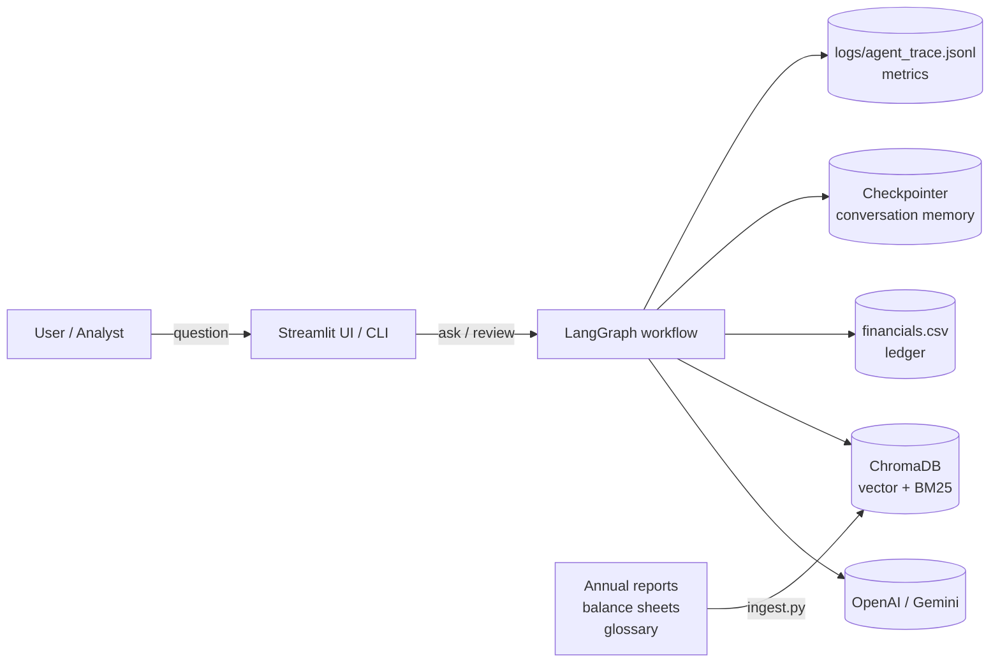
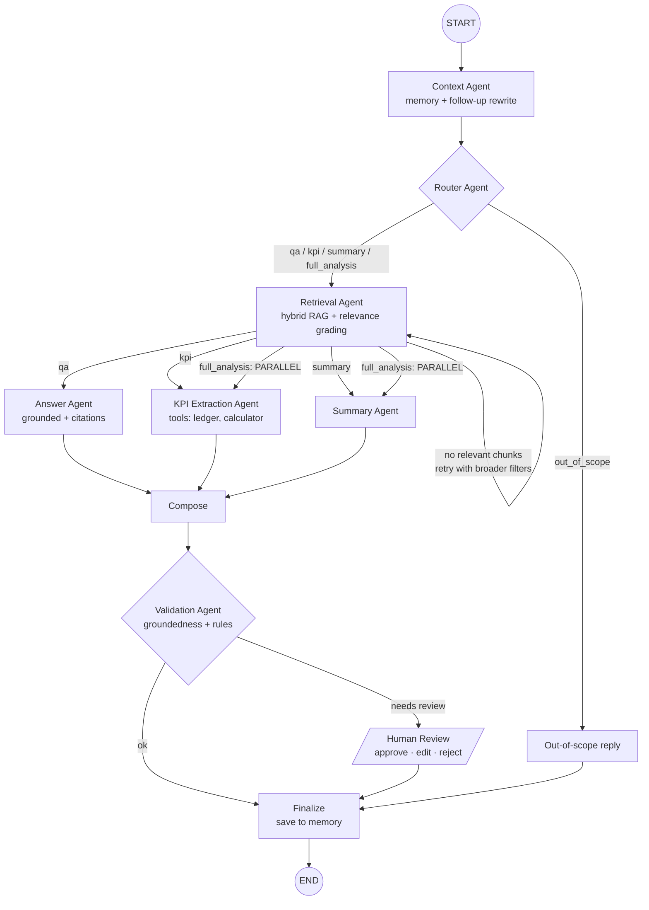

# Architecture - AI Financial Document Q&A Assistant

## 1. System overview

## 2. Agent workflow (LangGraph)

| Pattern | Where |
|---|---|
| **Sequential** | Context → Router → Retrieval → Specialist → Compose → Validation → Finalize |
| **Router** | `after_router`, `after_retrieval` (4-way + retry loop), `after_validation` |
| **Parallel** | `after_retrieval` returns `["kpi_agent", "summary_agent"]` for `full_analysis`. Both run in the same super-step and fan in at `compose` |
| **Loop / retry** | `retrieval_agent → retrieval_agent` while `retrieval_status == "retry"` (max 3) |
| **Human-in-the-loop** | `human_review` calls `interrupt()`. The graph state is check-pointed and resumed with `Command(resume=decision)` |

## 3. Agent responsibilities

| Agent | Role | Tools | LLM use | Fallback when LLM is down |
|---|---|---|---|---|
| Context Agent | Resolve follow-ups ("previous year", "it"), extract company/year, maintain entity memory | known companies/years | Standalone-question rewrite (JSON) | Regex entities + explicit context string |
| Router Agent | Pick route | `detect_metrics` | Classification (JSON, closed label set) | Keyword rules |
| Retrieval Agent | Hybrid search with metadata filters, multi-query for summaries, relevance grading, retry ladder | `search_documents` | - | - |
| Answer Agent | Grounded answer with `[n]` citations | - | Generation | Extractive best-sentence answer |
| KPI Extraction Agent | Extract metrics stated in documents, fetch ledger values, compute ratios and YoY growth, flag discrepancies | `lookup_financials`, `compute_ratio` | Structured extraction (JSON), interpretation | Regex extraction, template narrative |
| Summary Agent | Executive summary (Overview / Performance / Risks / Outlook) | - | Generation | Extractive per-section summary |
| Validation Agent | Groundedness score + business rules → review decision | - | LLM-as-judge (JSON) | Numeric-support heuristic |
| Human Review | Analyst approves / edits / rejects | - | - | - |

## 4. When does a human have to approve?
The answer goes to human review when **any** of these is true:
1. A KPI stated in the document differs from the ledger by more than `KPI_DISCREPANCY_PCT` (1%)
2. Figures could not be verified against the ledger (e.g. an uploaded report)
3. The question asks for investment advice
4. The route is `full_analysis` (a report needs sign-off before release)
5. Validation confidence is below `REVIEW_CONFIDENCE_THRESHOLD` (0.6)
6. Any component failed and the workflow ran degraded

## 5. RAG design
* **Chunking**: `RecursiveCharacterTextSplitter`, 600 chars, 100 overlap. Each chunk is prefixed with `[Company | FY | doc_type]` so the embedding carries entity context.
* **Metadata**: `company`, `fiscal_year`, `doc_type`, `source`, `page`, parsed from the filename (or entered on upload).
* **Hybrid retrieval**: Chroma cosine search + in-memory BM25, fused with Reciprocal Rank Fusion (k=60). Vectors catch paraphrases, and BM25 catches exact financial terms such as "EBITDA" or "free cash flow".
* **Relevance grading**: a chunk is kept if its cosine distance ≤ threshold **or** it covers ≥ 50% of the question keywords. If nothing is kept, the agent retries: drop the year filter, then all filters.
* **Multi-query** for summaries: the question plus four facet queries (performance, risks, outlook, liquidity).
* **Grounding**: prompts force "ONLY the context" plus citations. A validator scores support, and the KPI agent cross-checks every number against the ledger.

## 6. Memory
* `MemorySaver` checkpointer keyed by `thread_id` (one per chat session). Swap in `SqliteSaver` for persistence across restarts.
* `messages` (reducer `operator.add`) keeps the dialogue. `active_companies` / `active_year` keep entity memory.
* Context is inherited only when the question looks like a follow-up ("and", "what about", "it", "previous year"…). This stops a stale context from leaking into unrelated questions.
* Per-turn fields are reset at the start of each turn. The `trace`/`errors` reducers accept `None` as a reset signal.

## 7. Robustness
| Failure | Handling |
|---|---|
| LLM timeout / rate limit | 3 retries with exponential backoff (tenacity) → optional fallback model → `LLMUnavailable` → agent rule-based fallback |
| LLM returns invalid JSON | Re-prompt once with the parse error; then fallback |
| LLM returns an invalid route | Treated as failure → rule router |
| No relevant chunks | Retrieval retry loop with broader filters; then "documents do not contain…" |
| Vector store missing / down | Retrieval returns empty + error; KPI agent still answers from ledger; run flagged for review |
| Any node exception | `@agent_node` wrapper logs the stack trace, records the error, and returns a partial update so the graph continues |
| Infinite loops | `recursion_limit=30`, retrieval max 3 attempts |

## 8. Observability
* `logs/agent_trace.jsonl`: one JSON line per agent step (`thread`, `turn`, `agent`, `status`, `ms`, `detail`) and per tool call.
* `logs/app.log`: warnings, retries, stack traces.
* `metrics.snapshot()`: requests, route distribution, average latency per agent, LLM calls, retries, fallbacks, reviews and their outcome. Shown live in the Streamlit sidebar.
* Optional: set `LANGCHAIN_TRACING_V2=true` + `LANGCHAIN_API_KEY` to send LangGraph traces to LangSmith.

## 9. Key design decisions (good Q&A material)
1. **Ledger as source of truth for numbers.** LLMs are unreliable at arithmetic and at copying numbers. Figures come from a structured tool, ratios from a calculator. The LLM is used to *read* the document, and disagreement triggers review.
2. **Every agent has a deterministic fallback.** The demo can't be killed by an API outage, and the fallbacks double as a baseline in evaluation.
3. **Routing before retrieval.** The route decides the retrieval strategy (multi-query for summaries, metric-term queries for KPIs).
4. **Interrupt-based HITL** instead of a UI-only check. The pause lives in the workflow state, so it works the same from the UI, the CLI or an API.
